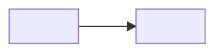

# Flow: Module N, <name>

**Approved:** YYYY-MM-DD by the owner. **Prototype:** `<PROTOTYPE_DIR>/module-N/`.

<!-- Saved as design/flows/module-N.md, written right after the owner approves the module's
prototype and drawn from it. The Approved line is the approval: /ticket-check refuses a frontend
ticket whose module has no flow, or whose screen is not one of the ### headings below. Until the
approval, write "**Approved:** not yet". After the module ships, update this file to match what was
built; it stays when the prototype is deleted. Delete this comment. -->

## Screens

One `###` heading per screen, named the way tickets name it. Under each, its screen brief.

### <screen name>

- **Route:** `/<path>`
- **Job:** <what a person comes here to do, in one sentence>
- **States:** <empty, loading, error, long content, the other role, what each shows>
- **Must not:** <what would make it wrong even if it looked polished>

## The flow

